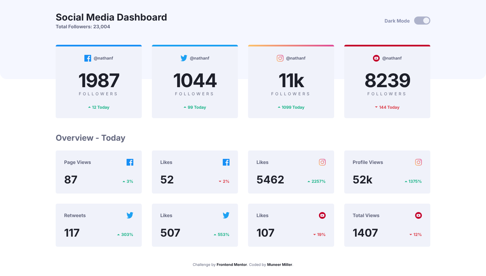
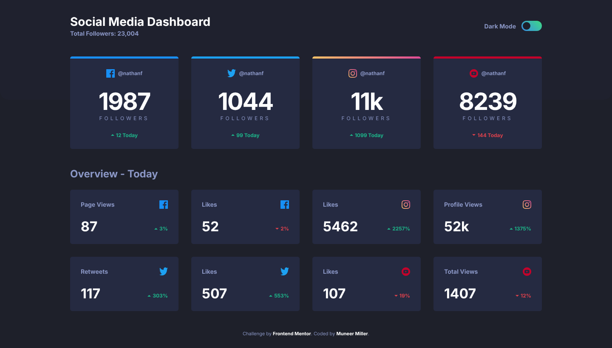
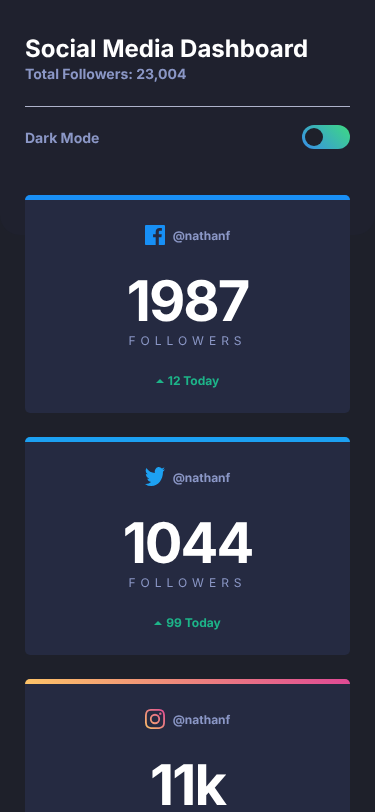

# Social Media Dashboard with Theme Toggle

A responsive **social media dashboard** that shows follower counts and daily engagement for Facebook, Twitter, Instagram and YouTube. It has an accessible light/dark theme switch that follows your system setting by default and remembers your choice.

Built as a solution to the [Frontend Mentor](https://www.frontendmentor.io?ref=challenge) "Social media dashboard with theme switcher" challenge.

| Light | Dark |
| --- | --- |
|  |  |

<p align="center">
  
</p>

## Table of Contents

- [Features](#features)
- [Getting Started](#getting-started)
- [Available Scripts](#available-scripts)
- [Project Structure](#project-structure)
- [How the Theme Toggle Works](#how-the-theme-toggle-works)
- [Accessibility](#accessibility)
- [Technologies Used](#technologies-used)
- [Deployment](#deployment)

## Features

- **Light/dark theme toggle.** Uses the operating system's `prefers-color-scheme` by default. A choice made with the toggle is saved in `localStorage` and restored on the next visit.
- **No flash of the wrong theme.** A small inline script applies the theme before the page first paints.
- **Works without JavaScript.** The CSS falls back to the system colour scheme on its own.
- **Responsive layout.** One column on mobile, two on tablets and four on desktop, using CSS Grid and Flexbox.
- **Modular Sass.** Styles are split into globals, components and utilities, with CSS custom properties for theming.
- **Live reload.** BrowserSync rebuilds and refreshes the page while you develop.

## Getting Started

Prerequisites: [Node.js](https://nodejs.org/) 16 or newer, and npm.

1. Clone the repository:

   ```bash
   git clone https://github.com/MuneerMiller/Social-Media-Tracker.git
   ```

2. Go to the project directory:

   ```bash
   cd Social-Media-Tracker
   ```

3. Install the dependencies:

   ```bash
   npm install
   ```

4. Start the development server. It opens the site in your browser and reloads on changes:

   ```bash
   npm start
   ```

The compiled `dist/` folder is committed, so you can also just open `index.html` in a browser without building anything.

## Available Scripts

| Command | What it does |
| --- | --- |
| `npm start` / `npm run dev` | Compiles Sass and JS, starts BrowserSync and watches for changes |
| `npm run build` | Compiles and minifies `app/` into `dist/` once |

The Gulp tasks behind these scripts (in `gulpfile.js`):

- `scssTask` compiles `app/scss/style.scss`, autoprefixes and minifies it with PostCSS into `dist/style.css`.
- `jsTask` transpiles `app/js/script.js` with Babel and minifies it with Terser into `dist/script.js`.
- `browserSyncServe` and `browserSyncReload` serve the site and refresh it.
- `watchTask` rebuilds when HTML, Sass or JS files change.

## Project Structure

```
.
├── index.html              # Dashboard markup
├── app/
│   ├── js/script.js        # Theme toggle logic
│   └── scss/
│       ├── style.scss      # Entry point
│       ├── globals/        # Colours/theme tokens, fonts, reset, typography, layout
│       ├── components/     # Header, toggle, cards, overview grid
│       └── util/           # rem() function and breakpoint mixins
├── dist/                   # Compiled CSS and JS (generated by `npm run build`)
├── images/                 # Platform icons and favicon
├── screenshots/            # Images used in this README
├── gulpfile.js             # Build pipeline
└── notes.md                # Development and accessibility notes
```

## How the Theme Toggle Works

1. An inline script in `<head>` reads the saved theme from `localStorage`. If none is saved, it uses `prefers-color-scheme`. It then adds a `light` or `dark` class to `<html>`.
2. `app/scss/globals/colors.scss` defines the theme tokens (`--background`, `--card-bg`, `--text-color` and so on) for `:root.light` and `:root.dark`, plus a `prefers-color-scheme` fallback for visitors without JavaScript.
3. `app/js/script.js` syncs the toggle with the active theme and saves the user's choice. Until a choice is saved, it also follows live changes to the system theme.

To reset to the system theme, clear the `colorMode` key from the site's local storage.

## Accessibility

- The toggle is a `fieldset` containing two radio buttons ([pattern by Scott O'Hara](https://scottaohara.github.io/a11y_styled_form_controls/src/radio-button--switch/)), so it works with the keyboard (Tab, then the arrow keys) and screen readers.
- A visible focus ring, a "Skip to content" link, and landmark regions (`header`, `main`, `footer`).
- Card lists use real headings and screen-reader-only text, for example "Page Views on Facebook" or "increase of 3%", so each card makes sense when read on its own.
- Decorative icons have empty `alt` text, and animations are minimised when the user prefers reduced motion.

## Technologies Used

- HTML5 with semantic markup
- Sass (SCSS) with CSS custom properties
- Vanilla JavaScript
- Gulp, Babel, Terser, PostCSS (Autoprefixer and cssnano) and BrowserSync

## Deployment

The site is static, so any static host works. For **GitHub Pages**, go to *Settings → Pages* and deploy from the `main` branch root. All asset paths are relative, so the site works from a sub-path such as `/Social-Media-Tracker/`.

Run `npm run build` and commit `dist/` before you deploy any style or script changes.

## Credits

- Challenge by [Frontend Mentor](https://www.frontendmentor.io?ref=challenge)
- Coded by [Muneer Miller](https://github.com/MuneerMiller)
